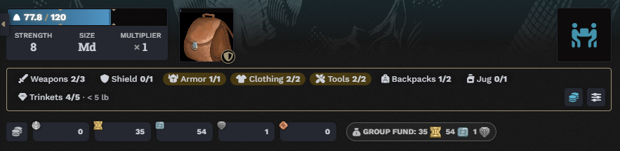

# Pack & Ledger

**Inventar, Gruppenvorräte und Münzen für D&D 5e in Foundry VTT.**

[](https://github.com/Flashiiio/Pack-and-Ledger/releases/latest)  

🇬🇧 [English](README.md) · 📖 [Wiki auf Deutsch](https://github.com/Flashiiio/Pack-and-Ledger/wiki/Startseite) · 📝 [Changelog](CHANGELOG.de.md)

Pack & Ledger hilft deiner Gruppe, Ausrüstung, Vorräte und Geld im Blick zu behalten. Das Modul erweitert das Inventar um verbindliche Behältergrenzen und Plätze am Körper. Dazu kommen Gegenstandshaufen auf der Karte, Handel, gemeinsame Vorräte und eine Gruppenkasse. Die Spielleitung kann Münzbewegungen und Charakteränderungen nachvollziehen.

## Was bietet das Modul?

### 🎒 Inventar und Behälter

Rucksäcke, Taschen und andere Behälter halten ihre Gewichts- und Stückzahlgrenzen ein. Direkt am Körper gibt es begrenzte Plätze für Waffen, Rüstung, Werkzeuge und weitere Ausrüstung. Gegenstände ohne freien Platz können automatisch in einem passenden Behälter verstaut werden.

Munitionsbehälter und Wasserschläuche nehmen nur ihren vorgesehenen Inhalt auf. Für gewöhnliche Behälter lässt sich wahlweise Überfüllen mit Reißrisiko erlauben: Reißt ein Behälter, verteilt sich sein Inhalt auf der Karte.

[](assets/readme/overview.png)

*Detail aus dem Charakterbogen: Die Leiste zeigt belegte Körperplätze; neben den Münzfeldern steht der für die Gruppenkasse reservierte Betrag. Die Aufnahme zeigt die englische Oberfläche.*

[Behälterregeln](https://github.com/Flashiiio/Pack-and-Ledger/wiki/Beh%C3%A4lter) · [Plätze am Körper](https://github.com/Flashiiio/Pack-and-Ledger/wiki/Pl%C3%A4tze-am-K%C3%B6rper)

### 💰 Gegenstandshaufen und Handel

Ziehe Gegenstände auf die Karte, um sie abzulegen, und hebe sie mit einem Charakter in Reichweite wieder auf. Die Spielleitung kann Haufen verstecken, Truhen verschließen und Gegenstände als unidentifiziert auslegen. Münzen aus einem Haufen lassen sich mit Vorschau gleichmäßig unter der Gruppe aufteilen.

Über ein gemeinsames Handelsfenster tauschen zwei Charaktere Gegenstände und Münzen. Beide sehen die Angebote und müssen zustimmen. Auch der Handel mit NSC ist möglich; für NSC ohne Spieler übernimmt die Spielleitung.

[Gegenstandshaufen](https://github.com/Flashiiio/Pack-and-Ledger/wiki/Gegenstandshaufen) · [Handel](https://github.com/Flashiiio/Pack-and-Ledger/wiki/Handel)

### 🍞 Gruppenvorräte und Rasten

Das Gruppen-Inventar zeigt Nahrung, Wasser und weitere Vorräte aller Spielercharaktere sowie mitgeführter Lager, etwa eines Wagens. Eine Übersicht berechnet, wie lange die Verpflegung reicht. Die Gegenstände bleiben in ihren jeweiligen Inventaren.

Die Spielleitung kann kurze und lange Rasten für die Gruppe ausrufen. Bei langen Rasten teilen die Beteiligten Nahrung und Wasser gemeinsam zu. Unterstützte magische Quellen und externe Versorgung, etwa in einem Gasthaus, können einbezogen werden. Optional berücksichtigt das Modul Erschöpfung durch Hunger und Durst.

[Gruppen-Inventar](https://github.com/Flashiiio/Pack-and-Ledger/wiki/Gruppen-Inventar) · [Rasten](https://github.com/Flashiiio/Pack-and-Ledger/wiki/Rasten)

### 🪙 Münzen, Gruppenkasse und Rechnungen

Reserviere Münzen für gemeinsame Zwecke wie „Boot“ oder „Reserve“. Sie bleiben im Geldbeutel des jeweiligen Charakters; vor dem Ausgeben reservierter Münzen erscheint eine Warnung. Die Gruppenkasse zeigt den Gesamtbetrag und die Beiträge der Charaktere.

Münzfelder unterstützen Berechnungen und automatisches Wechselgeld. Die Spielleitung kann Rechnungen mit mehreren Posten und wiederverwendbaren Vorlagen verschicken. Münzbewegungen werden in einem eigenen Protokoll erfasst.

[Münzen, Gruppenkasse und Rechnungen](https://github.com/Flashiiio/Pack-and-Ledger/wiki/M%C3%BCnzen-und-Rechnungen)

### 📜 Charakter-Tracker und Protokolle

Die Spielleitung kann Änderungen an Trefferpunkten, Zauberplätzen, Ressourcen und Inventar mit den Werten vor und nach der Änderung nachvollziehen. Gespeicherte Momentaufnahmen (Snapshots) ermöglichen den Vergleich mit einem früheren Stand und das Wiederherstellen ausgewählter Daten.

Ein eigener Reiter in der Seitenleiste zeigt neue Protokolleinträge. Im Protokoll-Fenster lassen sich Einträge durchsuchen, filtern und exportieren. Die gespeicherten Protokolle sind nur für die Spielleitung zugänglich.

[Charakter-Tracker](https://github.com/Flashiiio/Pack-and-Ledger/wiki/Charakter-Tracker) · [Protokoll](https://github.com/Flashiiio/Pack-and-Ledger/wiki/Protokoll)

Viele Funktionen lassen sich einzeln aktivieren und anpassen. Die Oberfläche ist auf **Deutsch und Englisch** verfügbar.

## Voraussetzungen

- **Foundry VTT 14.370**
- **dnd5e 6.1.0**

Kompatibel mit **Blind Skill Rolls**: Verborgene NSC-Namen bleiben auch beim Handel verborgen.

## Installation

1. Öffne in Foundry **Zusatzmodule → Modul installieren**.
2. Füge diese Manifest-URL ein und installiere das Modul:

   ```text
   https://github.com/Flashiiio/Pack-and-Ledger/releases/latest/download/module.json
   ```

3. Aktiviere **Pack & Ledger** in deiner Spielwelt unter **Spieleinstellungen → Module verwalten**.

## Erste Schritte

Die Spielleitung öffnet die Moduleinstellungen unter **Spieleinstellungen → Einstellungen konfigurieren → Pack & Ledger**. Dort lassen sich Behälterregeln, Plätze am Körper, Vorräte, Münzen und Protokolle an die eigene Runde anpassen.

- **Gegenstände ablegen:** Ziehe sie aus dem Inventar auf die Karte.
- **Handeln:** Nutze die Schaltfläche *Handeln* unter der Spielerliste.
- **Gruppen-Inventar öffnen:** Nutze die Token-Steuerung oder die Kachel im Standard-Charakterbogen.
- **Gruppenrast ausrufen:** Die Spielleitung nutzt die Schaltfläche *Rast* unter der Spielerliste.

## Anleitungen und Hilfe

Das **[Wiki](https://github.com/Flashiiio/Pack-and-Ledger/wiki/Startseite)** erklärt alle Funktionen, Regeln und Einstellungen mit Bildern und Beispielen.

- [Alle Einstellungen](https://github.com/Flashiiio/Pack-and-Ledger/wiki/Einstellungen)
- [Häufige Fragen und Hilfe](https://github.com/Flashiiio/Pack-and-Ledger/wiki/FAQ-und-Hilfe)
- [Änderungen der aktuellen Version](CHANGELOG.de.md)

Fehler oder Ideen? [Erstelle ein GitHub-Issue](https://github.com/Flashiiio/Pack-and-Ledger/issues) oder komm auf den [Discord-Server](https://discord.gg/upVqdYqg4p).
