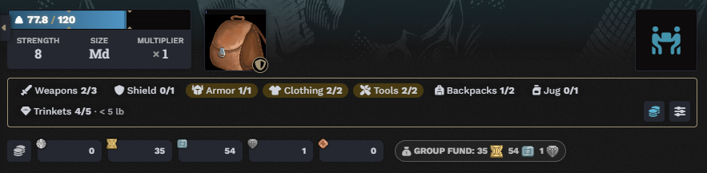

# Pack & Ledger

**Inventory, shared supplies and coins for D&D 5e in Foundry VTT.**

[](https://github.com/Flashiiio/Pack-and-Ledger/releases/latest)  

🇩🇪 [Deutsch](README.de.md) · 📖 [English wiki](https://github.com/Flashiiio/Pack-and-Ledger/wiki/Home) · 📝 [Changelog](CHANGELOG.md)

Pack & Ledger helps your group keep track of equipment, supplies and money. The module adds enforced container capacity limits and body slots to the inventory. It also provides item piles on the map, trading, shared supplies and a group fund. The GM can review coin movements and character changes.

## What does the module offer?

### 🎒 Inventory and containers

Backpacks, pouches and other containers enforce their weight and item count limits. Characters have limited body slots for weapons, armor, tools and other equipment. Items without a free slot can be automatically stowed in a suitable container.

Ammunition containers and waterskins accept only their intended contents. Ordinary containers can optionally be overfilled with a risk of tearing: if a container tears, its contents scatter onto the map.

[](assets/readme/overview.png)

*Character sheet detail: the bar shows occupied body slots; the amount reserved for the group fund appears next to the coin fields.*

[Container rules](https://github.com/Flashiiio/Pack-and-Ledger/wiki/Containers) · [Body slots](https://github.com/Flashiiio/Pack-and-Ledger/wiki/Body-Slots)

### 💰 Item piles and trading

Drag items onto the map to drop them, then pick them up with a character within reach. The GM can hide piles, lock chests and place unidentified items. Coins in a pile can be distributed equally among the group, with a preview before anything changes.

Two characters can exchange items and coins in a shared trade window. Both see the offers and must accept. Trading with NPCs is supported too; the GM handles NPCs without a player. NPCs can also run shops. Players add purchases and sales to a basket. The GM sees the basket live and can adjust prices. The deal is completed once both sides agree.

[Item piles](https://github.com/Flashiiio/Pack-and-Ledger/wiki/Item-Piles) · [Trading](https://github.com/Flashiiio/Pack-and-Ledger/wiki/Trading)

### 🍞 Shared supplies and rests

The group inventory shows food, water and other supplies carried by player characters and accompanying stores, such as a wagon. An overview calculates how long the provisions will last. Items stay in their respective inventories.

The GM can call short and long rests for the group. During long rests, participants allocate food and water together. Supported magic sources and external supplies, such as meals at an inn, can be included. The module can optionally apply exhaustion from hunger and thirst.

[Group inventory](https://github.com/Flashiiio/Pack-and-Ledger/wiki/Group-Inventory) · [Rests](https://github.com/Flashiiio/Pack-and-Ledger/wiki/Rests)

### 🪙 Coins, group fund and invoices

Reserve coins for shared purposes such as “Boat” or “Reserve”. Coins stay in each character’s purse; spending reserved coins displays a warning first. The group fund shows the total and each character’s contributions.

Coin fields support calculations and automatic change. The GM can send invoices with multiple items and reusable templates. Coin movements are recorded in a dedicated log.

[Coins, group fund and invoices](https://github.com/Flashiiio/Pack-and-Ledger/wiki/Coins-and-Invoices)

### 📜 Character tracker and logs

The GM can review changes to hit points, spell slots, resources and inventory, including their values before and after each change. Saved character snapshots allow comparison with an earlier state and restoration of selected data.

A dedicated sidebar tab shows new log entries. The log window lets the GM search, filter and export entries. Saved logs are accessible only to the GM.

[Character tracker](https://github.com/Flashiiio/Pack-and-Ledger/wiki/Character-Tracker) · [Log](https://github.com/Flashiiio/Pack-and-Ledger/wiki/Log)

Many features can be enabled and configured individually. The interface is available in **English and German**.

## Requirements

- **Foundry VTT 14.370**
- **dnd5e 6.1.0**

Compatible with **Blind Skill Rolls**: hidden NPC names stay hidden during trades.

## Installation

1. In Foundry, open **Add-on Modules → Install Module**.
2. Paste this manifest URL and install the module:

   ```text
   https://github.com/Flashiiio/Pack-and-Ledger/releases/latest/download/module.json
   ```

3. Enable **Pack & Ledger** in your world under **Game Settings → Manage Modules**.

## Getting started

The GM opens the module settings under **Game Settings → Configure Settings → Pack & Ledger**. Adjust container rules, body slots, supplies, coins and logs to suit your group.

- **Drop items:** Drag them from the inventory onto the map.
- **Trade:** Use the *Trade* button below the player list.
- **Open the group inventory:** Use the token controls or the tile on the standard character sheet.
- **Call a group rest:** The GM uses the *Rest* button below the player list.

## Guides and support

The **[wiki](https://github.com/Flashiiio/Pack-and-Ledger/wiki/Home)** explains all features, rules and settings with images and examples.

- [All settings](https://github.com/Flashiiio/Pack-and-Ledger/wiki/Settings)
- [Frequently asked questions and support](https://github.com/Flashiiio/Pack-and-Ledger/wiki/FAQ-and-Support)
- [Changes in the current version](CHANGELOG.md)

Found a bug or have an idea? [Open a GitHub issue](https://github.com/Flashiiio/Pack-and-Ledger/issues) or join the [Discord server](https://discord.gg/upVqdYqg4p).
